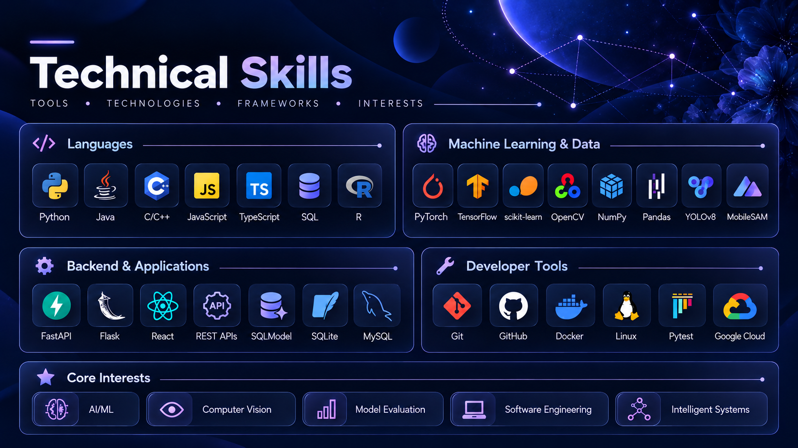

  

# Hi, I'm Sanaa Karkera!

**Computer Science + Computational & Data Sciences @ George Mason University**

**AI/ML | Software Engineering | Computer Vision | Applied Research**

## About Me

I'm a Computer Science and Computational & Data Sciences student at George Mason University with strong interests in artificial intelligence, machine learning, software engineering, and computer vision. I enjoy learning technical concepts in depth and applying them through research, experimentation, and software development. My work so far has included machine learning experimentation, backend systems, computer vision research, and AI-assisted applications, and I'm especially interested in building intelligent systems that are both technically rigorous and practically useful.

I'm currently interested in **Software Engineering, AI/ML Engineering, and Research Engineering internships**, where I can contribute to meaningful technical work while continuing to grow as both an engineer and a researcher.

## Technical Skills

  

## Featured Projects

### ReproPilot | ML Experiment Analysis
**Python, Flask, Gemini API, Pandas, Google Cloud**

Built an AI-assisted tool for assessing the reproducibility of machine learning experiments. It examines results for issues such as limited random-seed coverage, possible data leakage, and inconsistent evaluation metrics. I applied the tool to results from **12 classification and computer vision experiments** to make reliability issues easier to identify and investigate.

### Object Interaction Detection Service | Computer Vision + Backend Engineering
**Python, FastAPI, OpenCV, MobileNet-SSD, SQLModel, SQLite, Pytest**

Developed a video-analysis API that combines pretrained object detection with motion classification and proximity-based logic to identify human-object interactions. The system supports video uploads, persistent processing records, structured event outputs, and keyframe extraction. I also wrote **20+ automated tests** covering geometry, event logic, and API behavior.

### Ripple | AI-Assisted Decision Support
**TypeScript, React, Vite, Rules-Based Logic, API Integration**

Developed a student-facing application that helps explain the possible academic implications of dropping a course. The system combines AI-assisted information extraction with explicit decision rules and supporting sources to make complex policies easier to understand without treating generated responses as unquestionable answers.

## Additional Projects & Technical Research

### Meta-Machine Learning for Stress Prediction | Predictive Modeling

**Random Forest, Machine Learning, Hyperparameter Optimization, Survey Data**

Developed and evaluated a survey-based machine learning approach for identifying relationships between individual factors and stress outcomes. The work incorporated data preparation, model comparison, and hyperparameter tuning, with the Random Forest-based pipeline achieving **over 90% testing accuracy**. The research explored how predictive models could inform more targeted support strategies.

### Non-Small-Cell Lung Carcinoma Prognosis | Medical AI Research

**Convolutional Neural Networks, Deep Learning, Medical Imaging**

Explored CNN-based methods for computer-aided lung cancer prognosis using chest radiographs, CT imaging, and patient information. The research focused on how image-derived features and clinical context could inform risk assessment and support medical decision-making, rather than replace clinical expertise.

### Medical LLM Evaluation | NLP & Empirical AI Research

**GPT-4, BERT, Natural Language Processing, Evaluation Methodology**

Evaluated **GPT-4 and BERT across 500 medical prompts**, examining factual accuracy, contextual relevance, ethical soundness, and differences by query specificity. The study investigated where language-model responses may be useful and where reliability limitations become important in health-related applications.

### Intelligent Indoor Navigation | Probabilistic Estimation Research

**Kalman Filters, Particle Filters, Sensor Fusion, Position Estimation**

Investigated probabilistic filtering approaches to indoor positioning, focusing on how sensor noise and accumulated drift affect location estimates. Examined Kalman and particle filters as methods for integrating uncertain measurements and improving the stability of navigation estimates.

## Research Experience

### Oceanic AI Fellowship | Computer Vision Research
**Commonwealth Cyber Initiative / William & Mary / Virginia Institute of Marine Science**

Worked with a four-person research team on computer vision methods for analyzing underwater HabCam survey imagery. We trained and evaluated **YOLOv8s** detection models across **six survey years**, studied domain shift, annotated **200 additional images**, retrained detector variants, and explored **MobileSAM** for preliminary scallop size estimation. One retrained model achieved **0.872 all-class mAP@0.5**, and our team received the **Best Project Award in the Computer Vision Track**.

## Research Publications

### Testing the Accuracy of Modern LLMs in Answering General Medical Prompts
*International Journal of Social Science & Economic Research, 2023*

Evaluated **GPT-4 and BERT across 500 medical prompts**, examining factual accuracy, contextual relevance, and the effect of prompt specificity on model responses.

### Meta-Machine Learning Approach to Diagnose Stress from Individual Factors
*International Journal of Social Science & Economic Research, 2021*

Contributed to research applying **Random Forest classification** and **hyperparameter optimization** to survey-based stress prediction.

## Connect

- **LinkedIn:** [linkedin.com/in/sanaa-karkera-292258270](https://www.linkedin.com/in/sanaa-karkera-292258270/)
- **GitHub:** [github.com/sanaakarkera](https://github.com/sanaakarkera)
- **Email:** [sanaakarkera@gmail.com](mailto:sanaakarkera@gmail.com)
